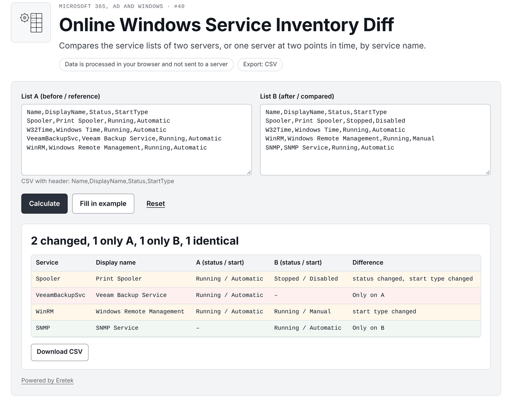

# Windows Service Inventory Diff

Compare two Windows service lists (Get-Service or Win32_Service CSV): status and start type changes, missing and new services. For change and incident checks.

## Try it live

- [Türkçe](https://sistem.eretek.com/araclar/windows-servis-karsilastirma)
- [English](https://sistem.eretek.com/en/tools/windows-service-diff)
- [Deutsch](https://sistem.eretek.com/de/werkzeuge/windows-dienste-vergleich)



## What it does

Compares the service lists of two servers, or one server at two points in time, by service name.

After an update, a security incident or an 'it used to work' complaint, comparing two service lists shows which service stopped or had its start type changed. Display names change with language and version, so the tool keys on the service Name.

## Where it helps

Match differences in critical services with change records. Unexpectedly stopped security or backup services should be investigated as part of incident response.

## How to use it

1. Export: `Get-Service | select Name,DisplayName,Status,StartType | ConvertTo-Csv -NoTypeInformation` (on older PowerShell `Get-CimInstance Win32_Service | select Name,DisplayName,State,StartMode`).
2. Paste both lists and press Calculate.

### Fields

| Field | Description |
|---|---|
| List A (before / reference) | CSV with header: Name,DisplayName,Status,StartType |
| List B (after / compared) |  |

## Example input

Press **Fill in example** in the tool to load this input.

**List A (before / reference)**

```text
Name,DisplayName,Status,StartType
Spooler,Print Spooler,Running,Automatic
W32Time,Windows Time,Running,Automatic
VeeamBackupSvc,Veeam Backup Service,Running,Automatic
WinRM,Windows Remote Management,Running,Automatic
```

**List B (after / compared)**

```text
Name,DisplayName,Status,StartType
Spooler,Print Spooler,Stopped,Disabled
W32Time,Windows Time,Running,Automatic
WinRM,Windows Remote Management,Running,Manual
SNMP,SNMP Service,Running,Automatic
```

**Expected result:** Spooler: Running/Automatic → Stopped/Disabled; WinRM start type Automatic → Manual; Veeam Backup Service missing on B; SNMP only on B.

## Method and assumptions

Rows are matched by service name (case-insensitive). Status/State and StartType/StartMode are compared if present; Auto and Automatic are treated as equal.

If a list lacks the start type column, that field counts as unknown and is not reported as a difference.

## Limits and common mistakes

- Service account, binary path and dependencies are not compared.
- Delayed start only appears as a separate value if the export contains it.

## Run it locally

The tool is plain HTML, CSS and JavaScript with no build step and no dependencies.

```bash
git clone https://github.com/eretek/windows-service-diff.git
cd windows-service-diff
node scripts/serve.js        # or: python3 -m http.server 8080
```

Open <http://127.0.0.1:8080/>. Add `?lang=tr` or `?lang=de` for Turkish or German; without it the page follows the browser language and falls back to English. You can also open `index.html` directly from disk.

Run the tests (Node.js 18 or later):

```bash
node test/run.js    # or: npm test
```

The tests run the tool's own fixtures and the worked examples in all three languages without a browser.

## How it works

All processing happens in your browser. The tool makes no network requests, uses no cookies or browser storage, and does not upload files you select.

No server-side component is needed. The version on the Eretek website renders the same page through a private WordPress plugin; that plugin only produces the page markup and is not part of this repository.

| Path | Purpose |
|---|---|
| `index.html` | Page shell |
| `src/app.js` | Builds the page in Turkish, English or German from `src/data.js` |
| `src/data.js` | Field definitions, examples and all texts in three languages |
| `src/core.js` | Shared runtime: validation, number formats, result rendering, CSV/ICS export |
| `src/tool.js` | The calculation or analysis for this tool |
| `docs/screenshot.png` | Screenshot used in this README |
| `src/tools.css`, `src/page.css` | Styles |
| `test/run.js`, `test/cases.json` | Headless tests |

## License and attribution

This tool is released under the [Eretek Website Attribution License](LICENSE). You may use, modify and redistribute it, including commercially. If you make it available on a website or web application, show a visible, clickable credit linking to https://eretek.com/ on every page where the tool is available, for example:

```html
<a href="https://eretek.com/">Powered by Eretek</a>
```

You may add `rel="nofollow"` to the link. Keep the copyright notice and license text in copies and redistributions.
